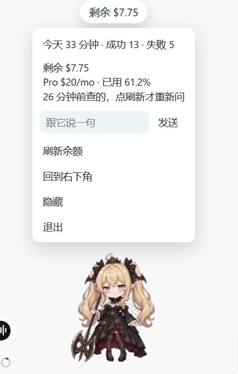

# cursor-pet

**中文** | [English](README.en.md)

跟随本机 Cursor Agent 状态切换动作的透明桌宠。当你向 Cursor 提问时，它在思考；Cursor 修改文件时，它在干活；任务完成或出错时，它会切换到对应姿势。

目前仅支持 **Windows**。运行前需已安装 Node.js，且本机已登录 Cursor。

## 效果预览

<p align="center">
  
  <br />
  <sub>右键菜单 —— 今日工时、套餐余额，以及一句话对话入口</sub>
</p>

<p align="center">
  
  <br />
  <sub>拖拽反馈 —— 被拎起时切换为惊讶姿势，并弹出提示气泡</sub>
</p>

## 运行方式

```powershell
git clone https://github.com/Reverie-t/cursor-pet.git
cd cursor-pet
npm install
npm run install-hooks
npm start
```

`npm run install-hooks` 会把状态上报钩子写入你用户目录下的 Cursor 配置。安装完成后如果桌宠仍无反应，请重启一次 Cursor。

关闭窗口后，下次本机 Agent 开始工作时它会自动重新打开；也可以再次执行 `npm start`。

## 右键菜单

- 查看今日 Agent 思考与工作的累计时长，以及成功、失败次数
- 查看上次记录的套餐余额；点击「刷新余额」才会重新向 Cursor 查询
- 跟它说一句话 —— 回复在本机生成，不消耗套餐额度
- 回到右下角
- 隐藏
- 退出

## 额度提醒

额度默认在用到 80% 时提醒一次，95% 和 100% 时各再提醒一次；同一档位每天只提示一次。如需调整提醒门槛，在 `logs/pet-settings.json` 中写入：

```json
{ "alertPercent": 70 }
```

## 许可

代码以 [MIT](LICENSE) 许可发布，署名 reverie。
